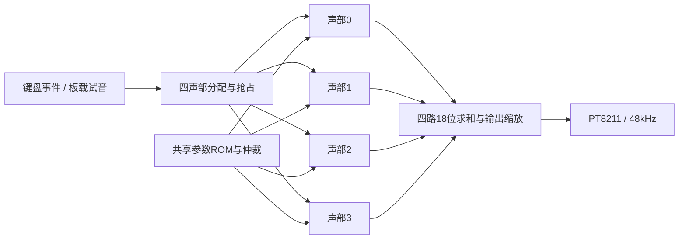

# 四声部架构

四个并行 `instrument_shared4_slot` 独立维护相位、包络和归属。钢琴与八种鼓合计共享四个声部。
每声部共享状态 RAM 和通用乘法资源，四声部之间保留并行计算；参数 ROM 通过四客户端仲裁共享。

分配器优先使用空闲声部，再选择已松键声部，最后按既定年龄规则抢占。抢占前保留 64 帧淡出。
`owner` 保存实体键号；`event_on=0` 按键号转发松键事件。实际松键声音还受音色与 ADSR 配置影响。
当前顶层默认 ADSR 配置与试听版一致，不擅自更改自然尾音。

混音等待四路 `sample_valid`，保存各路 PCM，再做 18 位有符号求和，输出为 `sum >>> 2`。
这个 /4 缩放仍保留，不能承诺单音试听幅度等于原单声部基线。

FIR 系数先读成完整 24 位 wire，再构造 25 位有符号系数，进入 DSP 前扩展为 27 位。
额外系数位保留噪声系数取负的精确范围，未降低精度或修改拟合参数。

实际综合列表在根目录 `.gprj`。`src/` 内未列入工程的原音源用于参考回归；吉他研究模块不属于当前四声部硬件功能。
