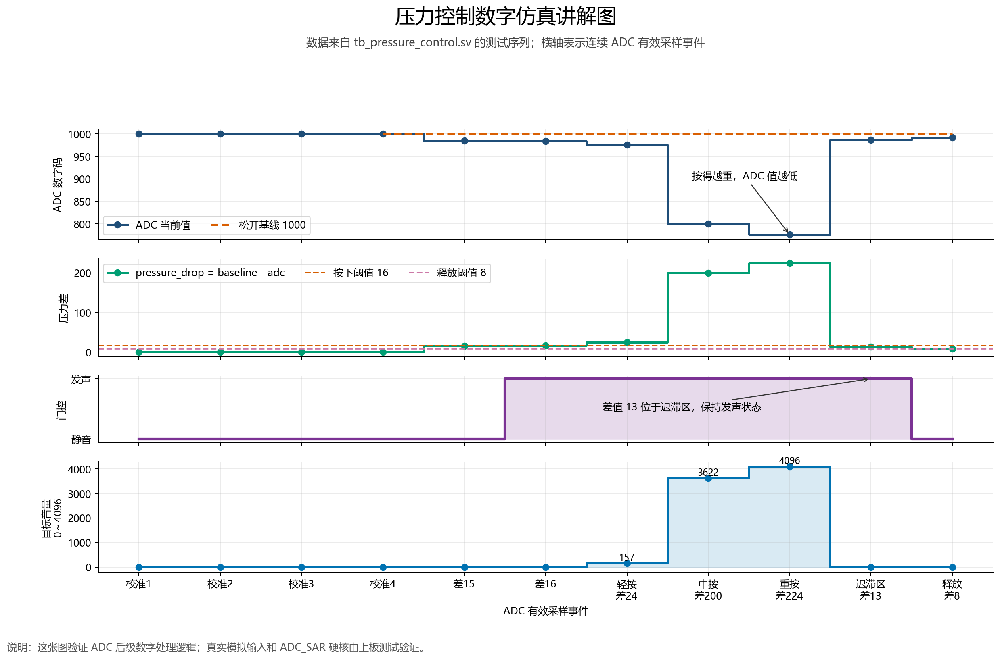

# 从 FSR 压力传感器到音乐响度的 FPGA ADC 学习复盘

> 适用工程：Tang Mega 60K SOM + NEO Dock 31004 Rev 1.4  
> 当前代码：`.`  
> 复盘目的：下周汇报时能够讲清楚为什么要学 ADC、硬件怎样连接、代码怎样处理、仿真验证了什么、实际遇到了哪些问题，以及最后实现了什么效果。

---

## 一、我这部分到底做了什么

我负责的是电子琴的外设输入。压力传感器需要同时充当“琴键”和“力度控制器”：

- 松开时不发声；
- 按下时发出固定的 A4，也就是约 440 Hz；
- 轻按声音小；
- 重按声音大；
- 松开后声音平滑消失，不能突然断开产生爆音。

FPGA 普通数字引脚只能稳定判断高电平和低电平，不能直接理解 0.3 V、0.5 V、0.8 V分别代表多大压力。因此我需要学习并使用 ADC，把连续变化的模拟电压转换为 FPGA 可以计算的数字码。

一句话概括完整链路：

```text
手指压力
  ↓
FSR 阻值变化
  ↓
FSR 模块的分压电路把阻值变化变为 S 脚模拟电压
  ↓
Tang Mega 60K 片内 SAR ADC 把电压转换为 13 bit 数字码
  ↓
建立松开基线，计算压力差，进行迟滞判断和力度映射
  ↓
用力度值控制三角波的数字幅度
  ↓
PT8211-S 把数字音频送到 NEO Dock 耳机接口
  ↓
听到声音随压力变化
```

这里要特别区分：

- **ADC 负责“电压变数字”**；
- **`pressure_control` 负责“数字变力度”**；
- **`pressure_tone` 负责“力度变声音幅度”**；
- ADC 不负责产生 440 Hz 音符，也不直接输出声音。

---

## 二、为什么 FSR 输出是模拟量

### 1. 裸 FSR 的本质

FSR 是 Force Sensitive Resistor，中文通常叫压敏电阻。压力改变时，它的电阻值会变化。裸 FSR 本身不是数字传感器，不能直接告诉 FPGA“压力是 30%”。

我买的是带三根引脚的成品模块：

- `VCC`：供电；
- `GND`：地；
- `S`：信号输出。

模块内部已经包含分压或调理电路，它把 FSR 阻值变化转换成 S 脚电压变化。因此，严格地说，是“FSR 模块的 S 脚输出模拟电压”。

### 2. 模块的 A/D 切换

这个模块有 A/D 切换功能：

- `A` 表示 Analog，输出连续变化的模拟电压，能表示力度；
- `D` 表示 Digital，经过比较器后只输出 0 或 1，只能表示按下或松开。

电子琴需要知道轻按和重按的区别，所以最终应使用 **A 模式**。D 模式即使能检测按键，也无法连续控制响度。

### 3. 我这只模块的方向是反的

实测发现，这款模块在 A 模式下是：

```text
压力越大 → S 脚电压越低 → ADC 数字码越小
```

所以代码不能写成“当前 ADC 值减去基线”，而要写成：

```text
压力差 = 松开时基线值 - 当前 ADC 值
```

这正是 `pressure_control.sv` 中 `pressure_drop` 的含义。

---

## 三、Tang Mega 60K 的片内 ADC 是什么

### 1. ADC 的含义

ADC 是 Analog to Digital Converter，模拟数字转换器。它对输入电压进行采样，并给出一个数字结果。

这个工程使用 GW5AT-60B 内部的 `ADC_SAR` 硬核。SAR 是 Successive Approximation Register，也就是逐次逼近型 ADC。可以把它理解成 ADC 内部不断比较“输入电压更接近上半区还是下半区”，经过多次比较后得到一个数字码。

当前代码读取 `ADCBIT[12:0]`，即 13 bit 原始结果。数字越大通常代表差分输入电压越高，但实际的零点、增益和力值关系仍需要用实物标定，不能只凭位数推算真实压力。

### 2. ADCV_P 和 ADCV_N

NEO Dock 的 J11 引出了专用模拟输入：

- `ADCV_P`：差分正端；
- `ADCV_N`：差分负端；
- 另一路为 `ADCT_P` 和 `ADCT_N`。

当前 FSR 是单端电压输出，因此接法是：

```text
FSR S    → ADCV_P
FSR GND  → J11 GND
ADCV_N   → J11 GND
FSR VCC  → 3.3 V
```

所有地必须共地。`ADCV_N` 不能悬空，否则 ADC 测量的是不确定的差分电压。

### 3. 为什么 CST 中看不到 ADCV_P 和 ADCV_N

这两个模拟脚直接连接 FPGA 内部 ADC 硬核，不是普通 GPIO。顶层模块也没有把它们写成普通输入端口，因此 CST 中不应该再写 `IO_LOC` 约束。

这点和普通 LED 引脚不同：

- LED、UART、音频时钟需要在 CST 中分配普通数字引脚；
- ADCV_P/N 由芯片的专用模拟硬核固定连接，不需要也不能按普通 GPIO 约束。

### 4. 输入电压安全范围

在第一次接线时，我们先用万用表测 S 脚，原因是模拟过压不能靠 Verilog 代码修复。项目当时按照板卡资料，把片内 ADC 外部输入控制在约 `0～1 V` 范围内。

最开始测到过约 `0.35～0.75 V`，处于可以继续测试的范围；后来切换模块或接法后又测到 `0～3.3 V`，这就不能直接送入 ADC。必须先在硬件上分压或调理，再连接 FPGA。

---

## 四、片内 ADC 控制代码怎样工作

关键文件：`rtl/io/onchip_adc_scan.sv`

### 1. ADC 硬核实例

代码实例化了高云提供的 `ADC_SAR` 原语：

```systemverilog
ADC_SAR adc_hard_block (
    .ADCBIT(adc_value),
    .EOC(adc_ready),
    .CLKI(clk),
    .CHEN(channel ? 7'b0000010 : 7'b0000001),
    .RSTN(rst_n),
    .SOC(adc_request)
);
```

几个核心信号是：

| 信号 | 含义 | 本工程中的作用 |
|---|---|---|
| `SOC` | Start of Conversion | 给一个脉冲，命令 ADC 开始转换 |
| `EOC` | End of Conversion | ADC 转换完成后给出完成状态 |
| `ADCBIT` | ADC 数字结果 | 取得 13 bit 原始转换码 |
| `CHEN` | Channel Enable | 在 ADCV 与 ADCT 两路之间选择 |

### 2. 状态机

代码没有在一个时钟里完成所有事情，而是用状态机按顺序控制：

```text
ST_STARTUP
   ↓ 等待片内模拟硬核稳定
ST_SETTLE
   ↓ 切换通道后等待模拟输入稳定
ST_REQUEST
   ↓ SOC 拉高一个或多个时钟，启动转换
ST_WAIT_LOW
   ↓ 先确认旧的 EOC 已经被清零
ST_WAIT_HIGH
   ↓ 等待新的 EOC 变高，保存 ADC 数字结果
   └──────────────→ 切换通道，再回到 ST_SETTLE
```

在 50 MHz 时钟下：

- 一个时钟周期为 20 ns；
- 上电等待 65536 个周期，约 1.31 ms；
- 通道切换后默认等待 64 个周期，约 1.28 μs；
- 超过 2,500,000 个周期仍未完成，约 50 ms，置 ADC 故障标志。

### 3. 为什么必须先等 EOC 变低，再等它变高

这是这次代码中很有价值的经验。`EOC` 可能保留上一笔转换完成时的高电平。如果发出新的 `SOC` 后立即判断 `EOC==1`，程序可能把旧完成信号当成新数据，结果一直读取第一次采样，甚至状态机看起来像“卡死”。

所以当前代码采用：

1. 发出 `SOC`；
2. 进入 `ST_WAIT_LOW`，看到 `EOC=0`；
3. 再进入 `ST_WAIT_HIGH`，看到新的 `EOC=1`；
4. 保存本次 `ADCBIT`。

这个过程保证每个 `sample_valid` 都对应一次真正完成的新转换。

### 4. 两路轮询

`channel` 在每次转换结束时翻转：

- `channel=0` 保存到 `sample0`，对应 ADCV；
- `channel=1` 保存到 `sample1`，对应 ADCT。

当前单压力电子琴只使用 `sample0`。`sample_valid` 在两路任意一路完成时都会产生一次脉冲，因此使用 ADCV 时，ADCT 完成的那次事件会再次处理尚未变化的 `sample0`。这不会改变相同数值的平均结果，但以后真正使用两路传感器时，最好增加 `channel_valid` 或分别输出 `sample0_valid`、`sample1_valid`。这是本次复盘后发现的一个可改进点。

---

## 五、ADC 数字码怎样变成力度

关键文件：`rtl/control/pressure_control.sv`

### 1. 为什么需要基线校准

同一只 FSR 在不同供电、分压、电阻误差和温度下，松开时的 ADC 数字码不一定相同。如果直接拿固定 ADC 值当阈值，换一只传感器就可能失效。

当前方案在上电后读取前 64 次有效样本并求平均：

```systemverilog
baseline <= (baseline_sum + adc_sample) >> 6;
```

因为 64 是 2 的 6 次方，所以除以 64 可以直接右移 6 位，不需要在 FPGA 中使用复杂除法器。

因此，上电或复位时必须完全松开 FSR。否则程序会把“按住时的值”当成无压力基线，松开和再次按压都会不正常。

### 2. 压力差

当前模块按得越重，ADC 值越低：

```systemverilog
assign pressure_drop = calibrated && (baseline > adc_sample) ?
                       baseline - adc_sample : 13'd0;
```

如果当前值高于基线，代码把压力差钳位为 0，避免电源小幅向上漂移造成假按键。

### 3. 迟滞判断

代码不是只用一个阈值，而是两个：

```text
压力差达到 16：认为按下，note_gate=1
压力差降到 8：认为松开，note_gate=0
压力差处于 8～16：保持原来的状态
```

这叫迟滞。若只有一个阈值，例如 16，ADC 噪声在 15、16、17 之间波动时，音符会不断开关，产生抖动和杂音。采用 16/8 两个阈值后，按下和松开的边界分开了。

### 4. 力度映射

按下阈值是 16，满力度设置为 224。代码把 `16～224` 的压力差近似线性映射到 `0～4096`：

```systemverilog
pressure_above_on = pressure_drop - 16;
volume_scaled     = pressure_above_on * 315;
volume_target     = volume_scaled >> 4;
```

这是：

```text
目标音量 ≈ (压力差 - 16) × 315 ÷ 16
```

使用乘法和右移代替任意除法，更适合 FPGA。压力达到 224 后直接限制到 4096，防止继续加压造成数字音频幅度无限增加。

需要说明：FSR 本身是非线性的，所以当前线性映射是第一版演示方案。将来可以用分段映射或查找表改善手感。

---

## 六、力度怎样体现为音乐响度

关键文件：`rtl/audio/pressure_tone.sv`

### 1. 音高和响度是两个不同变量

- 音高由 DDS 的 `phase_step` 决定，当前固定为 A4 约 440 Hz；
- 响度由 `current_level` 决定，来自压力传感器。

因此按压力传感器只改变声音幅度，不改变音符频率。

### 2. 为什么不能突然把声音打开和关闭

若按下时把幅度从 0 突然改成 4096，松开时又突然改为 0，波形可能在非零位置被截断，耳机里会听到“啪”或爆音。

所以代码在每个约 48.828 kHz 音频采样点缓慢追踪目标音量：

- 起音每点增加 32；
- 释音每点减少 16；
- 从 0 到最大力度约需要 `4096 ÷ 32 ÷ 48828 ≈ 2.6 ms`；
- 从最大力度回到 0 约需要 `4096 ÷ 16 ÷ 48828 ≈ 5.2 ms`。

这既能减少爆音，又使控制链路仍有机会满足 10 ms 延迟目标。

### 3. 幅度相乘

三角波先由 DDS 相位累加器生成，再乘以 `current_level`：

```systemverilog
scaled_product = triangle_wave * current_level;
sample_out     = scaled_product >>> 12;
```

轻按时 `current_level` 小，波形峰值小；重按时 `current_level` 大，波形峰值大。PT8211-S 最后把数字采样输出到耳机通路，人耳就听到响度变化。

---

## 七、顶层怎样把模块串起来

关键文件：`rtl/board/pressure_audio_top.sv`

```text
onchip_adc_scan
    │ adc0 + sample_valid
    ▼
pressure_control
    │ note_gate + volume_target
    ▼
pressure_tone
    │ 16 bit 音频 sample_value
    ▼
pt8211_tx
    │ hp_bck / hp_ws / hp_din
    ▼
NEO Dock PT8211-S 和耳机接口
```

顶层还做了三件事：

1. `audio_startup` 上电约 100 ms 后才打开音频功放；
2. ADC 故障时用 `safe_gate` 阻止新声音，已有声音仍平滑释音；
3. PMOD0 八颗 LED 显示就绪、压力档位和 ADC 超时。

PMOD LED 是低电平点亮，所以代码最后使用了取反 `~`。这一点曾造成“为什么灯亮灭方向和想象相反”的困惑。

---

## 八、仿真是怎样做的



### 1. 一个重要边界

普通 Icarus Verilog 仿真不能真实产生手指压力，也不能完整模拟芯片内部模拟 ADC 的电压转换过程。因此本工程采用两层验证：

- **数字仿真**：假设 ADC 已经给出数字码，验证基线、阈值、音量映射和音频幅度；
- **实物上板**：验证片内 `ADC_SAR`、真实电压、接线和硬件响应。

汇报时不要说“仿真证明了模拟 ADC 电压一定正确”。更准确的说法是：

> 仿真证明 ADC 后面的数字处理逻辑正确，片内 ADC 硬核和模拟接线通过实际板卡验证。

### 2. `tb_pressure_control.sv`

测试为了加快仿真，把 64 次校准缩短为 4 次，给出以下假 ADC 数据：

| ADC 输入 | 基线差 | 预期结果 |
|---:|---:|---|
| 1000，重复 4 次 | 0 | 基线校准为 1000 |
| 985 | 15 | 未达到 16，不发声 |
| 984 | 16 | 达到按下阈值，门控打开 |
| 976 | 24 | 目标音量为 157 |
| 800 | 200 | 目标音量为 3622 |
| 776 | 224 | 音量钳位为 4096 |
| 987 | 13 | 位于迟滞区，继续保持发声 |
| 992 | 8 | 达到释放阈值，关闭门控 |

这份仿真验证的是校准、方向、迟滞和映射。

### 3. `tb_pressure_audio_path.sv`

这份仿真把 `pressure_control` 和 `pressure_tone` 连起来：

- 轻按：ADC=960，压力差 40；
- 重按：ADC=776，压力差 224；
- 松开：ADC=992，压力差 8。

当前测试结果：

```text
PASS tb_pressure_audio_path light=472 hard=4085
```

说明重按时输出波形峰值明显大于轻按，松开后 `current_level` 和 `sample_out` 都回到 0。

### 4. `tb_pressure_tone.sv`

它验证：

- 起音步进能到达目标值；
- 目标力度减小时可以平滑下降；
- 最大输出不会超过预定安全幅值；
- 松开 256 个音频采样点后完全静音。

### 5. 2026 年 9 月 20 日重新执行结果

已重新执行 `scripts/run_tests.py`。包括压力控制、压力音频链路和 PT8211 在内的全部现有测试均显示 `PASS`。其中压力音频链路仍为：

```text
light=472
hard=4085
release=0
```

---

## 九、实际调试过程中遇到的问题

下面按我们实际聊天和调试顺序复盘。

### 问题 1：一开始不知道板载 ADC 能不能直接接 FSR

最开始的问题是 Tang Mega 60K 是否有可用片内 ADC、能否接多个压力传感器。最后确认 NEO Dock 引出了 ADCV 和 ADCT 两对专用模拟输入，可以完成前期两路验证，但不能直接满足最终 13 个压力键。

结论：

- 一两个传感器可以先用片内 ADC 学习和验证；
- 最终 13 键仍需要外置多通道 ADC，例如两块 MCP3208，或者使用模拟多路复用方案。

### 问题 2：把 V+、V- 与 ADCV_P、ADCV_N 的含义弄混

当时看到板上的 V+ 和 V-，不确定是不是信号正负端，也问过 ADCV_N 是否还要接地。对于当前单端 FSR 模块，正确思路是：

- S 接差分正端 ADCV_P；
- ADCV_N 接模拟地；
- 模块地、J11 地和 FPGA 系统地共地。

### 问题 3：最初测到 0.35～0.75 V，后来突然变成 0～3.3 V

第一次测量时电压在 ADC 安全范围内；后来模块开关、接法或输出模式变化后，S 脚最大变为 3.3 V。这个问题不能通过“降低 Verilog 数字值”解决，因为过压发生在 ADC 转换之前。

解决原则：

1. 先断开 FPGA；
2. 用万用表测松开、轻按、重按三种电压；
3. 超过 ADC 安全范围时先分压或调理；
4. 确认安全后再接 ADCV_P。

### 问题 4：手头只有 1 kΩ 电阻，分压后信号变得很小甚至不响应

当时用低阻值插件电阻搭了分压，出现过：

- S 端约 0.9 V；
- ADCV_P 只有约 0.2 V；
- 后来最大只有约 0.23 V；
- 按压后变化不明显。

原因不是 ADC 一定坏了，而是 1 kΩ 级分压网络对 FSR 模块输出负载较重，改变了原模块本身的工作点。分压不仅“按比例缩小电压”，还会反过来影响信号源。

更合理的做法是使用更高阻值，例如当时计划的 33 kΩ/10 kΩ，或使用成品电压调理模块。当前验证工程为了先跑通，在小电压变化下重新设置了较密的 LED 阈值。

### 问题 5：A/D 切换不知道选哪边

为了控制响度，需要连续模拟值，所以选择 A 模式。若选 D 模式，输出只会在 0 和 1 之间跳变，看起来像普通按钮，无法表现轻按和重按。

### 问题 6：LED 引脚约束报 PR2028 和 PR2017

当时 `led_n[0:3]` 被约束到了器件专用 CPU 引脚，Gowin 报：

```text
PR2028 The constrained location is useless in current package
PR2017 cannot be placed ... dedicated pin CPU
```

这不是 ADC 算法错误，而是板卡引脚约束错误。后来改为 NEO Dock PMOD0 LEDx8 的正确引脚：

```text
P19、R19、T21、U21、P16、R17、R18、T18
```

之后布局布线才能通过。

### 问题 7：LED 现象与预期相反

曾经出现过“一颗常亮”“不按时亮、按下时灭”等现象。一部分原因是 PMOD LED 为低电平点亮；另一部分原因是传感器按压后电压下降，和直觉中“压力越大数值越大”相反。

最终代码同时处理了这两个方向：

- 用 `baseline - adc_sample` 得到正向压力差；
- 输出 LED 时取反，因为硬件低电平点亮。

### 问题 8：不知道是否必须接 HDMI 才能看出 ADC 成功

ADC 第一次验证不需要 HDMI。LED 和 UART 更适合定位问题：

- LED7 慢闪：等待 ADC 或校准；
- LED7 常亮：ADC、校准和音频已就绪；
- LED0～6：压力档位；
- 两组 LED 交替闪烁：ADC 超时；
- UART 可看到原始 ADC、压力差、门控和音量。

先用最小系统验证 ADC，再增加音频和 HDMI，能减少同时排查多个模块的难度。

### 问题 9：重新烧录后仍只有一颗灯，怀疑 ADC 没工作

最终发现“一颗就绪灯常亮”并不一定表示失败。若 ADC 已就绪但压力差低于第一档，正常现象就是只亮就绪灯。后来按压能让压力灯发生变化，说明 ADC 已经返回有效数据。

这促使调试界面明确区分：

- “ADC 没启动”；
- “ADC 正常，但当前压力为零”。

### 问题 10：Gowin 出现 PR1014 时钟警告

Gowin 报告 `sys_clk_d` 使用通用时钟资源，可能带来延迟或偏斜。它是警告，不是本次构建失败原因。当前 `pressure_audio` 工程综合和布局布线通过，Setup/Hold 违例端点都是 0。

正确判断方法不是只看有没有黄色文字，而是继续检查：

- 是否有真正的 ERROR；
- Setup/Hold 违例端点是否为 0；
- 实物功能是否稳定。

### 问题 11：上电校准时如果按住传感器，会导致之后没有反应

前 64 次采样用于建立松开基线。如果上电时按住 FSR，基线就会错误。正确操作是：

1. 烧录或复位前松开 FSR；
2. 等待 LED7 常亮；
3. 再开始按压。

---

## 十、最终实现效果和证据

### 1. 片内 ADC 最小工程

`onchip_adc_sram.fs` 已于 2026 年 9 月 18 日通过实物验证：

- ADC 就绪灯常亮；
- 完成基线校准后，压力灯条随按压变化；
- 物理测试记录为 PASS。

对应验证文件：

```text
<USER_HOME>\Desktop\FPGA\tangmega60k-peripherals\build\ready-to-program\ONCHIP_ADC_VERIFIED.txt
```

### 2. 压力控制声音

用户实际验证结果：

- 固定 A4 测试音可以从耳机听到；
- FSR 轻按能够发声；
- 加大压力后声音更响；
- 松开后快速、平滑静音；
- LED0～6 随压力变化；
- LED7 能显示系统就绪。

### 3. 构建结果

`pressure_audio` 工程已完成：

- Gowin 综合；
- 布局布线；
- SRAM 位流生成；
- Setup 违例端点 0；
- Hold 违例端点 0。

资源占用记录：

- Logic：749 / 59904，约 2%；
- Register：334 / 60780，小于 1%；
- `MULTALU27X18`：2 个；
- `ADC_SAR`：1 个。

说明当前 ADC、力度计算和单音音频对 60K 器件来说资源占用很小，后续仍有空间扩展多键和四声部。

---

## 十一、复盘后我认为还可以改进的地方

这些不是当前演示失败，而是从“能跑”走向“比赛作品”时应该改进的点。

1. **为两路 ADC 分别增加有效脉冲。** 当前只有一个 `sample_valid`，单通道演示可以工作；多传感器时应知道本次数据来自哪个通道。
2. **ADC 故障恢复。** 当前 `timeout_fault` 一旦置 1，会保持到复位，属于安全但保守的策略。最终作品可改成连续多次超时才故障，并在成功采样后恢复。
3. **每只 FSR 单独标定。** 13 个传感器的松开值和灵敏度不会完全一致，应分别保存基线和满力度范围。
4. **增加数字滤波。** 当前主要依赖 64 次启动平均和迟滞。最终可增加低通滤波，减小手抖和电源噪声。
5. **改进力度曲线。** 人耳对响度不是线性感知，FSR 也不是线性器件。可以用分段查找表，让轻按更容易控制。
6. **测量真实延迟。** 代码中的包络时间可计算，但比赛的 10 ms 要求应包含传感器、ADC、数字处理、PT8211 和音频输出整条链路的实测。
7. **最终 13 键需要外置 ADC。** 片内引出的模拟通道不够，后续两块 MCP3208 到货后再完成 13 路 SPI 扫描。

---

## 十二、下周可以直接照着讲的汇报稿

下面是一版约 6～8 分钟的第一人称讲稿。

### 开场

我这周主要学习并完成了 FPGA 的 ADC 压力输入部分。电子琴不仅要知道按键有没有按下，还要知道按得轻还是重。普通 FPGA 数字输入只能判断 0 和 1，不能直接判断连续变化的压力，所以我需要先把压力传感器输出的模拟电压转换成数字量，再用这个数字量控制音乐响度。

### 原理

我使用的是三线 FSR 压力传感器模块。严格来说，FSR 本体是一个阻值随压力变化的压敏电阻，模块内部通过分压电路把阻值变化变成 S 脚电压。模块有 A 和 D 两种模式，D 模式只能输出按下或松开的 0、1 状态，A 模式可以输出连续电压。因为我要做力度控制，所以选择 A 模式。

Tang Mega 60K 芯片内部有 SAR ADC，NEO Dock 把它的 ADCV 正负输入引了出来。我把 S 接 ADCV_P，把 ADCV_N 接地，同时让传感器和 FPGA 共地。片内 ADC 的安全输入范围较低，因此接入前必须用万用表确认电压，超过范围时必须在硬件上分压，不能依靠代码解决模拟过压。

### ADC 代码

ADC 控制代码实例化了 `ADC_SAR` 硬核。程序通过 SOC 信号发起一次转换，通过 EOC 判断转换结束，然后读取 13 bit 的 ADCBIT。为了保证时序正确，我写了启动等待、通道稳定、发起转换、等待 EOC 清零和等待 EOC 再次置位这几个状态。先等 EOC 变低再等它变高，是为了防止把上一次转换的完成信号误认为新数据。

### 压力处理代码

传感器实测是按得越重，输出电压越低，所以程序上电时先在松开状态采集 64 次求平均，得到无压力基线。之后用“基线减当前 ADC 值”得到压力差。

为了避免 ADC 噪声让声音反复开关，我使用了迟滞：压力差达到 16 才认为按下，下降到 8 才认为松开。在 8 到 16 之间保持原状态。然后把压力差 16 到 224 映射成 0 到 4096 的目标音量。

### 音频处理

音高固定为 A4 约 440 Hz，压力只控制幅度。目标音量不会突然改变，而是在每个音频采样点逐步增加或减少。最大起音时间约 2.6 ms，最大释音时间约 5.2 ms，这样能减少按下和松开时的爆音。

### 仿真

仿真不能模拟真实手指和模拟电压，所以我给模块输入假 ADC 数字码。首先用 1000 建立基线；输入 985 时压力差为 15，不发声；输入 984 时达到 16，门控打开；输入 776 时压力差达到 224，音量达到上限 4096；回到 992 时压力差为 8，声音关闭。

完整链路仿真中，轻按音频峰值是 472，重按峰值是 4085，松开后归零。这个结果证明压力数字码能够正确改变声音幅度。真实 ADC 硬核和接线则通过上板测试验证。

### 遇到的问题

调试中我主要遇到四类问题。第一是模拟电压安全问题，传感器一度输出 3.3 V，不能直接接 ADC。第二是用 1 kΩ 电阻分压时负载太重，导致信号被拉低到约 0.2 V并且变化不明显。第三是 FPGA 约束错误，LED 被分配到专用 CPU 引脚，后来改成 PMOD0 的正确引脚。第四是 LED 为低电平点亮，加上传感器压力增大时 ADC 值反而减小，导致最初对亮灭方向判断错误。

### 最终效果

最后，片内 ADC 能稳定读取压力变化，LED 条会随压力变化；耳机中可以听到固定音符，轻按声音小，重按声音大，松开后平滑静音。数字仿真全部通过，Gowin 综合、布局布线和位流生成也通过，Setup 和 Hold 违例都是 0。

### 收尾

通过这部分我理解了，ADC 只负责把模拟电压变成数字码，真正的力度控制还需要基线校准、迟滞、映射和音频包络。下一步是把同样的方法扩展到 13 个压力按键，并通过外置多通道 ADC 实现和弦演奏。

---

## 十三、老师可能追问的问题

### 1. 为什么不用数字输出 D 模式？

D 模式只有 0 和 1，只能判断按下和松开，不能表示轻按和重按，因此不能连续控制响度。

### 2. 为什么 ADCV_N 要接地？

片内 ADC 测量的是 ADCV_P 与 ADCV_N 的差分电压。当前传感器是以地为参考的单端输出，所以负端接同一个地，正端接 S。

### 3. 为什么上电时必须松开？

程序把前 64 次采样平均值当作无压力基线。如果上电时按住，基线就错误，后续压力差也会错误。

### 4. 为什么使用两个阈值 16 和 8？

这是迟滞，用来抵抗 ADC 噪声。达到 16 才按下，降到 8 才松开，可以避免在一个阈值附近反复开关。

### 5. 16、224 是电压值吗？

不是，它们是 ADC 数字码的差值。要换算成真实电压或牛顿力，需要结合 ADC 参考、模拟前端和传感器曲线进行实物标定。

### 6. 为什么 64 次平均用右移 6 位？

因为 64 等于 2 的 6 次方，除以 64 等价于右移 6 位，FPGA 实现简单、资源少。

### 7. 仿真有没有真正模拟 ADC？

没有完整模拟模拟电压转换。仿真给出假 ADC 数字码，验证 ADC 后面的数字逻辑；真实 ADC 硬核、输入电压和接线通过实物上板验证。

### 8. 压力为什么只影响响度，不影响音高？

音高由 DDS 相位步进值决定，当前固定为 440 Hz；压力映射到波形幅度，所以只改变响度。

### 9. 片内 ADC 能不能直接做 13 个压力键？

当前底板只提供有限的专用模拟输入，无法直接接 13 路。最终方案需要外置多通道 ADC，例如两块 MCP3208。

### 10. 目前是否已经证明总延迟小于 10 ms？

数字包络起音约 2.6 ms，说明设计方向满足低延迟需求，但比赛要求应对完整输入到声音输出链路进行实测，当前还不能把计算值当成最终测量结果。

---

## 十四、汇报时建议展示的材料

1. 一张完整信号链框图：FSR → 模块分压 → ADC → 压力处理 → DDS 幅度 → PT8211 → 耳机。
2. 一张硬件接线照片，标出 ADCV_P、ADCV_N、3.3 V 和 GND。
3. `onchip_adc_scan` 的五状态流程图。
4. 一张仿真波形，只保留：`adc_sample`、`baseline`、`pressure_drop`、`note_gate`、`volume_target`、`current_level`、`sample_out`。
5. `tb_pressure_audio_path` 的结果：轻按 472、重按 4085、松开 0。
6. 一段实机视频：上电松开校准，轻按、重按、松开，同时拍到 LED 和耳机输出。
7. 最后一页列出后续工作：13 键外置 ADC、每键标定、四声部和完整延迟测量。

---

## 十五、必须记住的五句话

1. FSR 本体改变的是电阻，模块通过分压产生模拟电压。
2. ADC 只完成模拟电压到数字码的转换，力度判断由 FPGA 数字逻辑完成。
3. 当前模块按得越重 ADC 值越小，所以压力差是“基线减当前值”。
4. 仿真验证的是 ADC 后级数字逻辑，真实模拟 ADC 必须上板验证。
5. 当前单键已经跑通，13 键和四声部还需要外置多通道 ADC 和最终系统集成。

